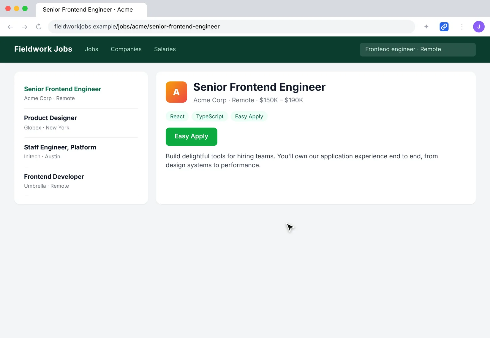
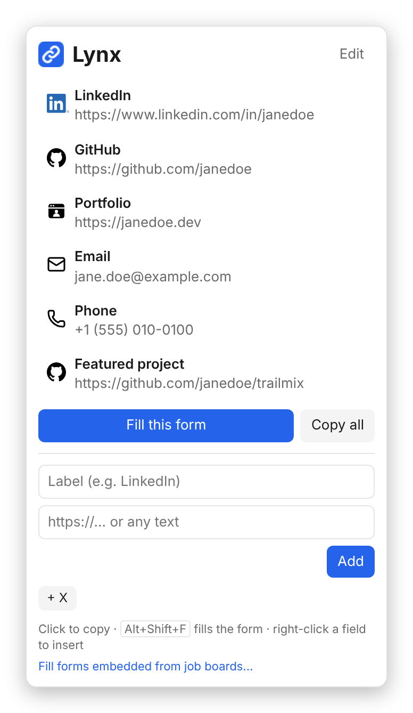
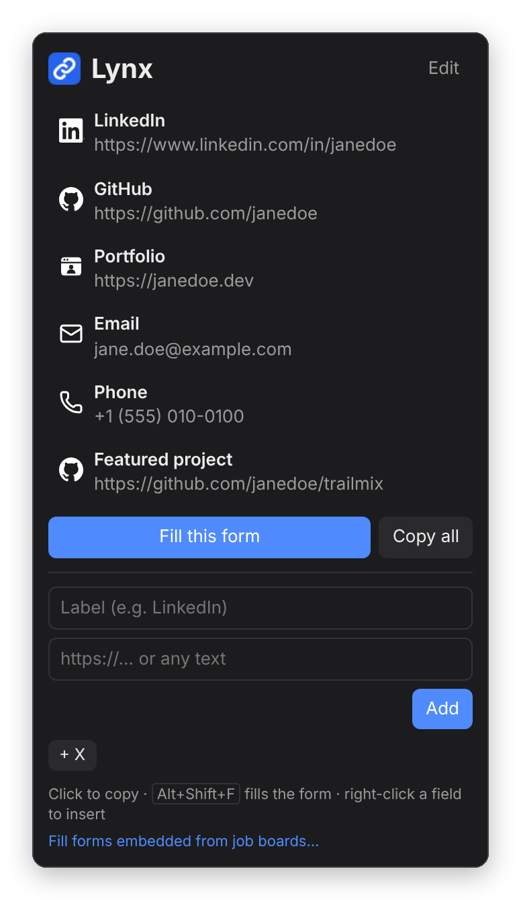

# Lynx

A small browser extension that keeps your LinkedIn, GitHub, portfolio, and other links one click away, for job applications and sign-up forms.

**What sets it apart:** Lynx can fill a whole job application's link fields in one keystroke, but it only touches a page when you ask it to. Autofill extensions usually need permission to read every site you visit. Lynx asks for none.

  
  

Lynx follows your system's light or dark mode.

## How to use it

- **Fill the form:** on an application page, press `Alt+Shift+F` (or click **Fill this form** in the popup). Lynx finds the LinkedIn, GitHub, portfolio, email, and similar fields and fills the empty ones. Each filled field glows briefly so you can check it. Fields that already have something in them are left alone.
- **Copy a link:** click the toolbar icon, then click a link. It's on your clipboard, ready to paste.
- **Keyboard:** open the popup with `Alt+Shift+L`, then press `1`–`9` to copy that link.
- **Copy all:** puts every link on your clipboard as a `Label: link` list, for "anything else to share?" text boxes.
- **Insert directly:** right-click any text field, choose **Insert link from Lynx**, and pick a link. It goes straight into the field.
- **Manage links:** add links at the bottom of the popup (the quick buttons fill in LinkedIn, GitHub, and so on). Click **Edit** to rename, reorder, or delete them.

Your links are kept in `chrome.storage.sync`, so they follow your browser profile across devices. Nothing is sent anywhere else. See the [privacy policy](PRIVACY.md).

## Install (developer mode)

1. Clone this repo.
2. Open `chrome://extensions` (or `edge://extensions`, `brave://extensions`).
3. Turn on **Developer mode**.
4. Click **Load unpacked** and select the `src` folder.
5. Pin Lynx to the toolbar.

### Firefox

1. Open `about:debugging#/runtime/this-firefox`.
2. Click **Load Temporary Add-on…** and select `src/manifest.json`.

A temporary add-on is removed when Firefox closes. Firefox 121 or newer is required.

There's no build step: it's plain HTML, CSS, and JavaScript.

## Permissions

| Permission | Why |
| --- | --- |
| `storage` | Saves your links |
| `contextMenus` | Adds the right-click "Insert link" menu on text fields |
| `activeTab` + `scripting` | Fills or inserts into the current page, and only right after you use the shortcut, the **Fill this form** button, or the right-click menu |
| Job-board sites (optional, off by default) | Fills application forms embedded from Greenhouse, Lever, Ashby, Workday, SmartRecruiters, Workable, Jobvite, and iCIMS. Only requested if you click **Allow job boards**. |

Lynx never runs on a page in the background and doesn't request access to any site.

**Embedded forms:** some company career pages embed the application form from a job-board site such as Greenhouse, Lever, or Ashby. Lynx can't reach into those embeds by default. If **Fill this form** finds an embed, the popup offers **Allow job boards**. You can also turn it on from the link at the bottom of the popup. This grants access to a short list of job-board sites only (see `optional_host_permissions` in `src/manifest.json`), and Lynx still only acts when you ask it to.

## Files

The extension itself lives in `src/`:

- `src/manifest.json`: extension config (Manifest V3)
- `src/popup.html` / `src/popup.css` / `src/popup.js`: the toolbar popup
- `src/fill.js`: form-field matching, shared by the popup and background script
- `src/background.js`: the right-click menu, the fill shortcut, and field insertion
- `src/icons/`: the extension's icons and the logos shown next to each link (see Credits)

Everything else is about the project:

- `docs/`: the demo and screenshots above
- `PRIVACY.md`: the privacy policy

## Credits

**Icons**

- Email and phone icons: [Lucide](https://lucide.dev), [ISC License](https://lucide.dev/license). Copyright (c) Lucide Contributors 2022; portions copyright (c) Cole Bemis 2013–2022 as part of Feather (MIT).
- X icon by [Icons8](https://icons8.com).
- Portfolio icon and the Lynx extension icons were made for this project.

**Trademarks**

LinkedIn, GitHub, and X logos are trademarks of their respective owners and are used only to label links to those sites. Lynx isn't affiliated with or endorsed by LinkedIn, GitHub, or X.

- LinkedIn "In" logo: [LinkedIn brand guidelines](https://brand.linkedin.com/downloads)
- GitHub Invertocat logo: [GitHub logos and usage](https://github.com/logos)